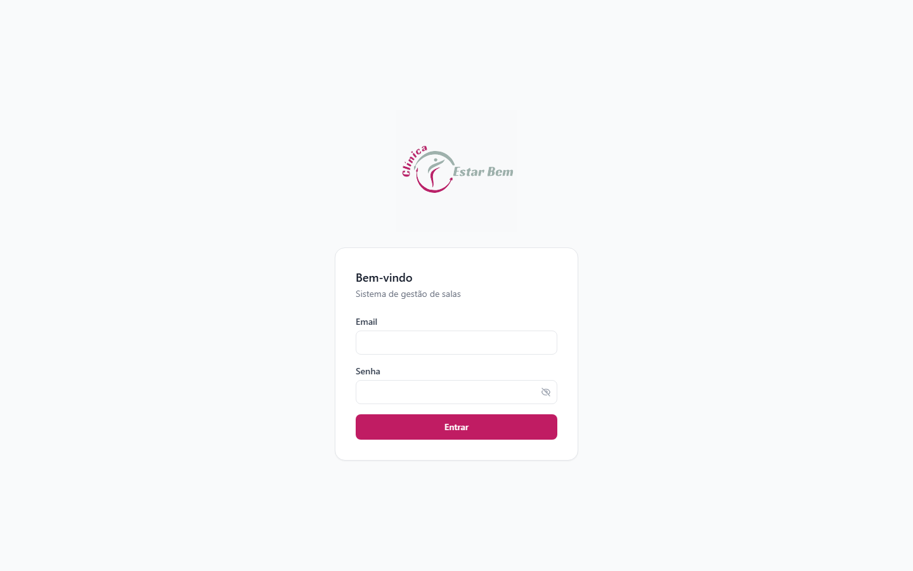
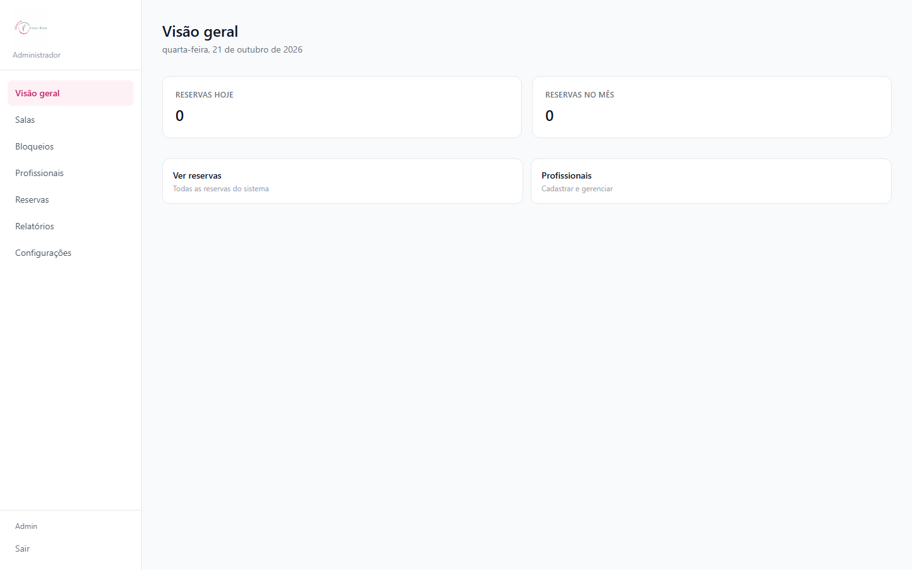
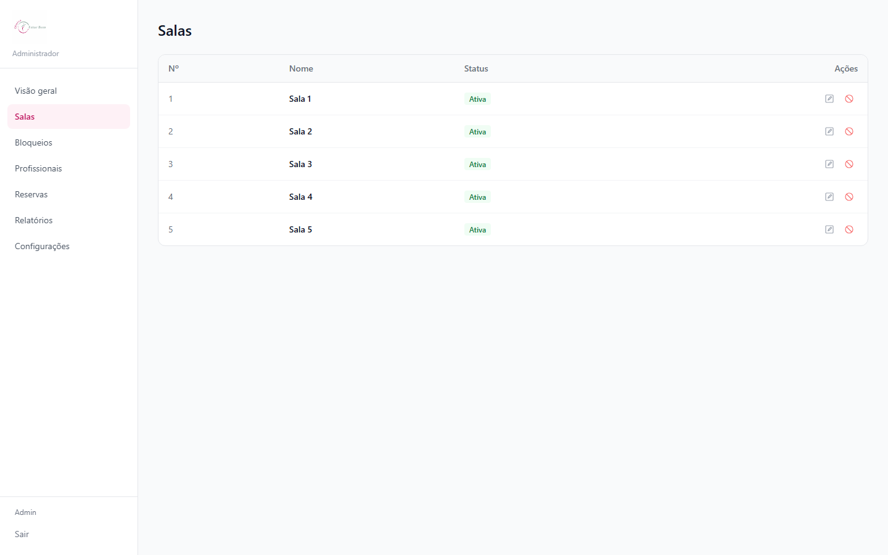
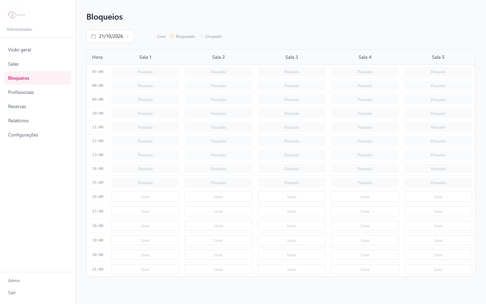
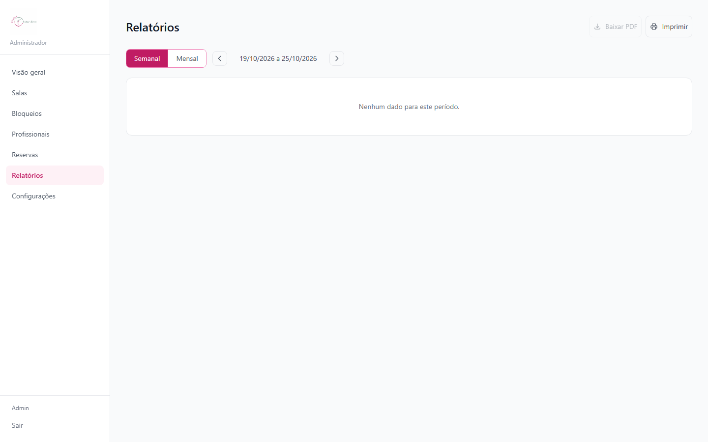
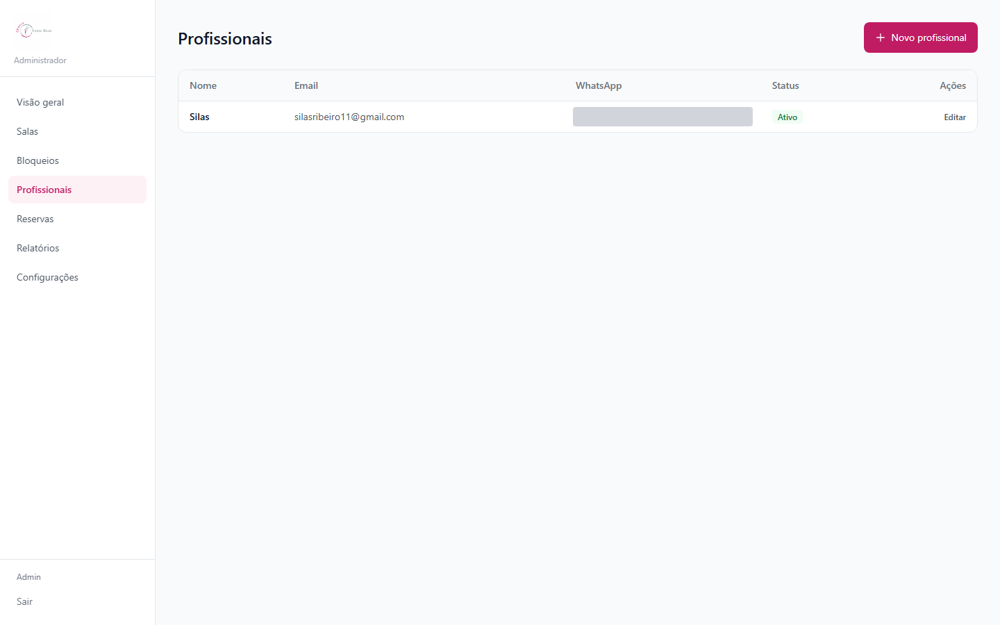
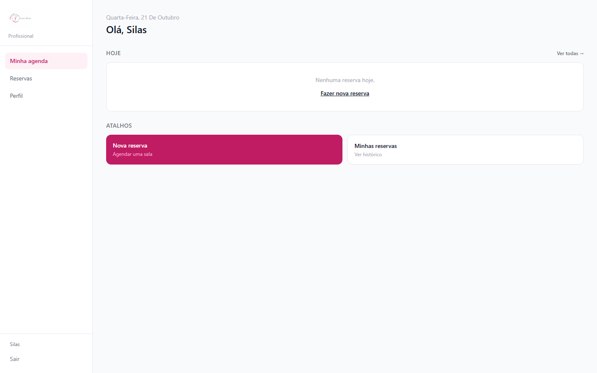
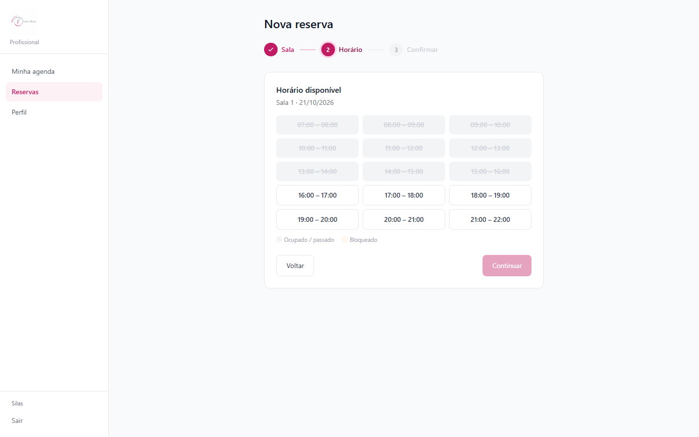

# Núcleo Estar Bem

**Sistema de agendamento de salas para clínicas que operam em coworking, com controle de disponibilidade em tempo real, bloqueios administrativos e relatórios de ocupação.**

---

## Sobre o projeto

A Clínica Estar Bem funciona no modelo coworking: psicólogos sublocam salas de atendimento por hora. Antes do sistema, esse agendamento era controlado manualmente, sem visibilidade de conflitos de horário nem histórico de ocupação.

O Núcleo Estar Bem resolve isso com um painel único onde:

- A **administração** cadastra salas e profissionais, bloqueia horários (manutenção, eventos) e acompanha ocupação por relatório semanal/mensal.
- Cada **profissional** vê sua própria agenda e reserva uma sala em 3 passos — sala, horário disponível, confirmação — sem risco de dupla marcação.

Credenciais de acesso são geradas automaticamente e enviadas por email ao cadastrar um profissional, sem intervenção manual da administração.

**Status:** em produção, atendendo a clínica.

---

## Prévia

| | |
|---|---|
| **Login** | **Visão geral do administrador** |
|  |  |
| **Salas cadastradas** | **Bloqueio de horários** |
|  |  |
| **Relatório de ocupação** | **Profissionais cadastrados** |
|  |  |
| **Agenda do profissional** | **Nova reserva — seleção de horário** |
|  |  |

---

## Funcionalidades

**Agendamento**
- Reserva de sala em 3 passos (sala → horário disponível → confirmação), sem conflito de horário
- Verificação de disponibilidade em tempo real, considerando reservas e bloqueios existentes
- Cancelamento com tolerância configurável e detecção automática de no-show via cron

**Administração**
- Cadastro de salas e profissionais, com ativação/desativação
- Bloqueio manual de horários por sala (manutenção, eventos, indisponibilidade)
- Relatórios de ocupação semanais e mensais, com exportação em PDF

**Acesso e notificações**
- Autenticação por perfil (administrador / profissional), com permissões distintas por rota
- Envio automático de credenciais por email ao cadastrar um profissional
- Lembretes e confirmações por WhatsApp e notificações in-app

---

## Arquitetura e stack

| Camada | Tecnologia |
|---|---|
| Frontend | Next.js (React) + Tailwind CSS |
| API | Node.js + Fastify |
| Banco de dados | PostgreSQL via Supabase |
| Autenticação | Supabase Auth (JWT), com middleware de sessão no Next.js |
| Email transacional | SendGrid |
| Notificações | WhatsApp (Baileys) |
| Cron jobs | node-cron (lembretes diários, detecção de no-show) |
| Deploy API | Railway |
| Deploy Frontend | Vercel |

Uma ação do profissional (ex: criar uma reserva) passa pelo Next.js, que chama a API Fastify autenticada por JWT do Supabase. A API valida a disponibilidade da sala direto no PostgreSQL, grava a reserva e dispara as notificações (email/WhatsApp) de forma assíncrona. O painel administrativo lê os mesmos dados via Supabase, com políticas de RLS garantindo que cada profissional só veja suas próprias reservas.

---

## Estrutura do projeto

```
sistema/
├── api/                     # API Fastify
│   └── src/
│       ├── routes/          # auth, rooms, professionals, reservations, cancellations, reports, whatsapp
│       ├── services/        # integrações (email, whatsapp, notificações)
│       ├── middlewares/     # guards de autenticação e permissão por role
│       ├── plugins/         # plugins Fastify (supabase, cors, etc.)
│       └── cron/            # lembretes diários e detecção de no-show
├── web/                     # Frontend Next.js
│   └── src/
│       ├── app/
│       │   ├── (auth)/      # login
│       │   ├── (admin)/     # painel administrativo
│       │   └── (psychologist)/  # painel do profissional
│       ├── components/      # AppShell, SidebarNav, DatePicker, etc.
│       └── lib/supabase/    # clientes Supabase (browser e server)
├── supabase/
│   └── migrations/          # schema do banco versionado
├── docs/
│   └── portfolio-screenshots/
├── spec.md                  # especificação funcional e de dados
├── sprints.md                # histórico de desenvolvimento por sprint
└── NOTAS_TECNICAS.md         # soluções para problemas já enfrentados em produção
```

---

## Como rodar localmente

**Pré-requisitos**
- Node.js 20+
- Uma conta Supabase (banco + auth)
- Conta SendGrid (envio de credenciais por email)

**Configuração**

```bash
# API
cd api
cp .env.example .env     # preencher com as credenciais do Supabase e SendGrid
npm install
npm run dev

# Frontend (em outro terminal)
cd web
cp .env.example .env.local   # preencher com a URL/chave pública do Supabase
npm install
npm run dev
```

| Serviço | Porta | URL |
|---|---|---|
| Frontend (Next.js) | 3000 | http://localhost:3000 |
| API (Fastify) | 3001 | http://localhost:3001 |

---

Desenvolvido por [Silas Ribeiro dos Santos](mailto:silasribeiro11@gmail.com).
